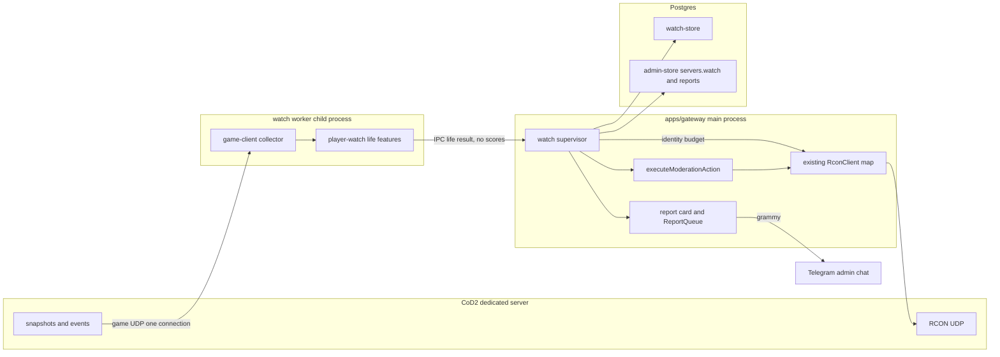
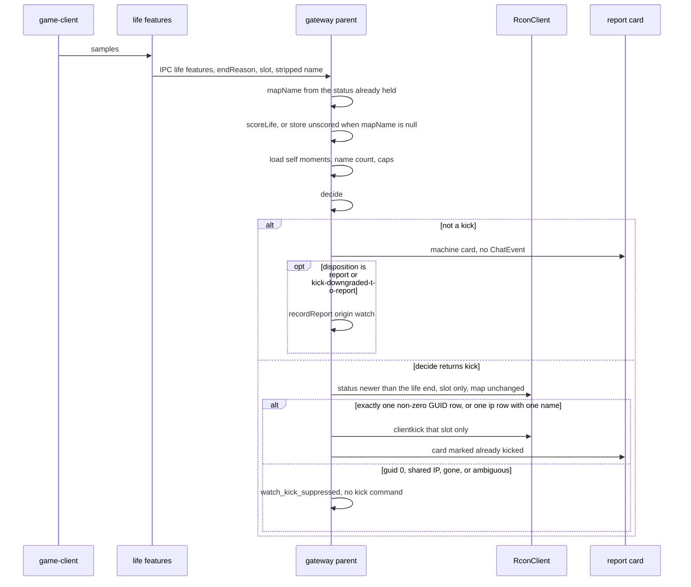

# Player-watch game bot for CoD2 Admin

| | |
|---|---|
| Status | Accepted. These product decisions are the plan. The protocol spike has not been run, and the Spike note is still empty. |
| Author | _(placeholder)_ |
| Date | 2026-11-08 |
| Product version | v1.20.0 (`db0410c`, branch `feat/player-watch-bot`) |
| Future repo path | `docs/PLAN-player-bot.md` (this document). Russian owner summary `docs/PLAN-player-bot-ru.md` is a separate follow-up after this English design is accepted. |

This is a design only. It does not add a package, a migration, or a client.

## Overview

The gateway today moderates Call of Duty 2 over RCON and, when `games_mp.log` is on disk, turns a player's `!report` into an admin card. It cannot see how anyone aims. Production CTF RUSSIA (~40 players, `185.158.113.146`) is managed from the NAS container `cod2admin-ctfrussia-gateway` with no log tail at all (`docs/PLAN.md` §3, `scripts/nas-ctfrussia.sh`). A poll of `rcon status` will never show a flick.

The proposal is a game client that joins as a player and does not play: one extra UDP peer per opted-in server, speaking the CoD2 connection protocol the way a human client does, not the OOB RCON protocol `RconClient` already speaks. It stays connected, reads the snapshots the server already sends that peer, and turns them into per-life features. Those features are scored against that identity's own history and against the server's population. A policy then does nothing, raises a flag, opens the existing report card, or asks the existing kick path to drop the player. The client does not aim, shoot, spoof a human, echo IWD checksums, or ban. The headless peer is used only where `getstatus` shows `sv_pure` `0` and `sv_punkbuster` `0`. A pure or PunkBuster server needs the real client, and that collector is not started until the spike note says so.

v1 is a classical score on a few aim and movement features. "Learning" means storing distributions, not training a network. Packet layouts are not treated as known until a protocol spike against the dev server parses a snapshot. The spike target is the Compose service `cod2_server` (`docker-compose.yml` has no `container_name`), reached on host port **28960** from the machine that runs Compose (`127.0.0.1:28960`). It is not the container DNS name `cod2server-server-1`, which this file does not define. If that spike cannot see other players' origins and viewangles, or the server rejects the client for `sv_pure` or PunkBuster, aim detection with the headless client stops there.

## Background & Motivation

Admins on this stack can kick, temp-ban, and ban, and they can read a card built by `packages/report-pipeline` (`processReportTrigger` → `buildReportCard` → `apps/gateway/src/lib/reports.ts`). The card is only as good as the player who typed `!report`. On CTF RUSSIA there is no `!report` path: `startReportTailer` logs that automation is off when `servers.log_source_config` is null (`apps/gateway/src/lib/report-tailers.ts`). The 10-second sweep in `startExpiryPoller` (`apps/gateway/src/lib/expiry-poller.ts`) is ban and VPN enforcement via `rcon status`. It is not a sensor for aim.

What the log *can* show, and why it is not enough, is in [Collectors](#collectors). `log-tailer` does not even parse `K;` / `D;` lines today (`packages/log-tailer/src/lib/session-event-parser.ts` returns null for them). A sample death line from `packages/log-tailer/test/fixtures/chat-lines.log` is:

```text
116:42 D;0;0;allies;WOWOWOW;0;0;allies;WOWOWOW;frag_grenade_british_mp;59;MOD_GRENADE_SPLASH;none
```

That is a kill with a weapon and a means-of-death. It has no viewangles. CTF RUSSIA does not feed the gateway that file anyway.

The owner wants three outputs, chosen per server:

| Mode | What the admin sees | What the bot does by itself |
|---|---|---|
| `flag` | A suspicion card with evidence | Nothing to the player |
| `report` | The same card, also queued like a `!report` | Nothing to the player |
| `kick` | The card, after the drop | `RconClient.kick` through the shared moderation path |

False kicks on a public 40-player server are worse than missed cheats. Kick mode ships off. Permanent ban is not an automatic action.

### Current constraints (verified)

- One Nx/pnpm product, fixed version, `release.projects: ["*"]` in `nx.json`. Packages at v1.20.0: `rcon-client`, `admin-store`, `ban-store`, `log-tailer`, `report-pipeline`, `telegram-relay`. Apps: `apps/gateway` (grammy + Fastify miniapp), `apps/miniapp-web`. New behavior is new packages plus a thin gateway supervisor. `rcon-client` stays the RCON library.
- Dev dedicated server: Docker image `bgauduch/cod2server:7.0.0-1_3_cracked-ibuddieat`, Compose service `cod2_server`, published host port 28960/udp (`docker-compose.yml`; no `container_name`). `server_mp.cfg` sets `sv_pure 1` (line 59), `sv_fps 20`, `sv_maxclients 20`, `sv_privateclients 0`, `sv_privatepassword` to a dev placeholder, `g_password ""`, `g_antilag 0`, `scr_spectatefree 0`, `g_forceteamspectate 0` (comment: `0` = killcam, `1` = team spectate), `scr_killcam 0`, `scr_spectateenemy 0`, and `sv_cracked 1`. Launch args force `sv_punkbuster 0`. `punkbuster.cfg` is still exec'd and only contains `pb_sv_guidrelax 7`. The image tag is the cracked 1.3 build; a connect that works only because that binary skips the CD-key check is not evidence a stock 1.0 server will accept the same userinfo.
- CTF RUSSIA: public `getstatus` reports `shortversion 1.0`, protocol 115, and the server also accepts 1.3 clients (protocol 118 in userinfo). Documented in `docs/PLAN.md` §2.4. Protocol is a per-server fact.
- GUID `0` is the common case. `dumpuser` is documented in §2.4 (name, not slot; CoD2x `cl_hwid` / `cl_hwid2` visible even on a stock server) and is **not implemented** anywhere under `packages/` or `apps/`. A search for `dumpuser` in `*.ts` returns nothing.
- `RconClient.kick` (`packages/rcon-client/src/lib/rcon-client.ts`) sends `clientkick <slot>` and, when that command is unknown, falls back to `kick <name>` or `kick <slot>`. Watch will not use that fallback. Human `/kick` still does. `executeModerationAction` (`apps/gateway/src/lib/moderation-actions.ts`) is the only moderation path the bot and the miniapp share. `banClient` refuses GUID 0. Bans stay human.
- RCON on the busy public server drops on the order of half of queries in bursts up to ~5 seconds (`docs/PLAN.md` §2.4). `RconClient` retries (default 8 attempts, 1s timeout, 300ms gap, 100ms minimum send interval). A missed `set` does not run. The watcher must not add a status loop.
- Text is CP1251. `decodeText` / `encodeText` live in `packages/rcon-client/src/lib/text-encoding.ts`. The Quake 3 tokenizer treats bytes above `0x7F` as whitespace outside quotes.
- Telegram from Russian hosts is blocked (`docs/PLAN-russia-access.md`). The CTF bot already runs on the NAS, outside Russia, and uses `telegram-routes.ts` when it needs a relay. The game client must not open a Telegram socket.
- Permissions are ids in `packages/admin-store/src/lib/permissions.ts`, not ranks. The owner (`admins.is_owner`) has every id. `OWNER_GRANTED_PERMISSIONS` is `rcon` and `update`: only the owner can newly grant those. `/kick` and the report-card Kick button both require `kick` (`bot.ts` `allow('kick')`, `actionPermission` in `reports.ts`). There is no metrics pipeline in the repo. Automatic kicks that exist today (`vpn-kick.ts`) audit with `actorTelegramId: 0`, `source: 'auto'`, which `formatTelegramUser` renders as `bot (automatic)`.
- `player_notes.watch` (`admin-store` schema) is a human watchlist on a GUID, IP, or name. It is unrelated. Suspicion state must not be written there.
- Implementers must not boot `apps/gateway` against the shared dev bot token. The NAS instance holds that token (`CLAUDE.md`, `scripts/nas-ctfrussia.sh`).

## Goals & Non-Goals

### Goals

- Join an opted-in CoD2 server as a non-playing observer and keep a normalized sample stream of other players the server chooses to send.
- Build per-identity and per-server distributions of a small feature set, and score new lives against both.
- Surface evidence to the existing admin card, and optionally kick through `RconClient.kick`, with hysteresis, a sample floor, and a cooldown.
- Default off. Survive GUID 0. Keep protocol selection per server. Stay inside the one-version Nx release.
- Prove the protocol on the dev server before any scoring code is trusted.

### Non-goals

- Playing the match, moving to objectives, or chatting as a fake teammate.
- A general anti-cheat, or coverage of every cheat family. v1 names its detectors below and defers the rest.
- Replacing human admins. Flag and report modes always leave the decision on the card.
- Modifying the game-server binary in v1. No CoD2x / libcod deploy on CTF RUSSIA.
- Automatic permanent bans, `ban.txt` writes, or IP bans from the watcher.
- Screenshot checks (`!getss`) and PunkBuster screenshots.
- Wallhack detection for an enemy who is not in this client's snapshot.
- A reliable spinbot-versus-lag classifier. `g_antilag` is `0` on the dev server and unknown on CTF; high ping and loss already exist on that public server.
- A neural net in v1. Stored features must be enough for one later.
- A second Telegram message layout, a second kick implementation, or a second systemd unit.
- Running the full gateway locally to test the client.

## Proposed Design

Three stages, with a hard gate between the first and the second.



The child parses UDP and emits feature numbers. It does not open Postgres and it does not call `decide`. The parent is the only writer of `watch-store`, and the only process that talks to Telegram, `ReportQueue`, or `RconClient`. It scores the life, updates moments, loads the self-life gate from the database, and calls `decide`. A kick request is not a kick. The parent re-reads settings, caps, and the status row before it calls `executeModerationAction`.

### Collectors

| Collector | Data | Works on CTF RUSSIA today | v1 role |
|---|---|---|---|
| Headless TS client, new `packages/game-client` | Origins, angles, events the server puts in this client's snapshots | **Not known.** RCON does not pass `sv_pure` or PunkBuster. A client with no `.iwd` set does not. Usable only where `getstatus` shows `sv_pure` `0` and `sv_punkbuster` `0`, and the spike saw enemies | Preferred only on a non-pure, non-PB server, behind the spike |
| Wine + real `CoD2MP_s.exe`, hook or log export | Whatever the real client renders. It has the IWD set `sv_pure` checks, and it can answer PunkBuster | The realistic answer if `sv_pure` is `1` or `sv_punkbuster` is `1` | Required before any pure or PB server, including CTF if `getstatus` says so. Same `Sample` type. Not started until the spike note says the headless client cannot serve that server |
| CoD2x / libcod module | Every player's viewangles, no PVS hole | No. We do not control that binary | Later optional collector, same `Sample` type |
| `rcon status` + `games_mp.log` only | Names, IPs, score, ping; `K;`/`D;` weapon and means-of-death **if** the log is mounted | Status yes, log no on CTF | Rejected as the primary design |

The log's weak signals are kills, weapon name, and `MOD_*`. They support a K/D or a weapon-class oddity at best. They cannot show a snap onto a newly visible enemy or a kill while looking elsewhere. `packages/log-tailer` does not parse them, and CTF has no tail. Building v1 on that stream would report "this player is getting kills," which humans already see on the scoreboard. If a server does have a log, a later enricher may attach the matching `D;` line to a life as a label. It is not the sensor.

### Visibility

A client only receives entities the server puts in the snapshot (PVS / snapshot culling, and `sv_maxSnapshotEntities` style caps in the libcod notes). Pre-aim through a wall is invisible until the enemy is already in the snapshot. The first snapshot that contains a new enemy is the earliest legal moment for a "snap" feature. The bot must not treat "enemy absent" as "enemy not aimed at."

The spike and PR 2 join as a spectator and do not reserve a private slot. A private slot is a later dev-only step if spectators are refused or see nobody. Never occupy a public slot. On the dev server a spectator is a narrow hole, not a camera. `server_mp.cfg` sets `scr_spectatefree 0`, `scr_spectateenemy 0`, `scr_killcam 0`, and `g_forceteamspectate 0` (killcam, not team spectate). A spectator may be refused, or may only follow a teammate's PVS. The private-slot fallback is one idle body: the usercmd builder never walks and never writes angles toward an entity, so that body stays at spawn and sees spawn. Snap-on-acquire exists only for enemies the server already put in this peer's snapshot. Seeing one nearby player is not the same as seeing fights on a 40-player CTF map. The spectator spike in [Protocol spike](#protocol-spike-go--no-go) counts enemies across the map. It does not reserve a private slot. A later private-join run that only sees spawn does not confirm snap-on-acquire. CTF's spectate cvars are not in the repo.

### Process model

Start the worker from `apps/gateway/src/main.ts`, beside `startExpiryPoller` and `startReportTailers`, only after migrations. One child per gateway process, and inside it one game connection per server whose `servers.watch` says `enabled`. The gateway already runs as the single long-running service (`installer/lib/service.sh`, container `cod2admin-ctfrussia-gateway`). A second unit would be a second install path for a feature that is off by default.

The child is a process, not a `worker_threads` worker and not work on the grammy loop.

- Snapshot decode is synchronous CPU at the rate the server actually sends. The client may request `snaps 20`. The dev `sv_fps` is 20, so that server will not send faster than that, but the spike records the interval that arrives. CTF clients in `docs/PLAN.md` §2.4 send `snaps 30`; the score uses the received rate, not the request. The main thread also runs grammy long-polling, Fastify, and the ban sweep. A decode loop that never returns would stop kicks of banned players and stop Telegram.
- `worker_threads` would get off the main thread but still shares the process fate, and it is easy to capture the rcon password in a closure.
- Spawn with `child_process.spawn`, and **not** the way `apps/gateway/src/lib/update-apply.ts` does. That helper uses `detached: true`, `unref()`, and stdio pointed at a file so the update survives the gateway being killed. The watcher needs the opposite: `stdio: ['pipe', 'pipe', 'pipe']`, no `detached`, no `unref`. The parent kills the child's process group on shutdown. Copying the update helper would leak the game connection and can leave a second copy running across a restart.
- Stdin and stdout are both newline-delimited JSON. The first line the parent writes to a new process is one `hello`. That object names every enabled server. A server with an owned or adopted private password has that secret on its own entry. A spectator server is named with no password. `hello` is the only message that carries a secret. Later lines to a running process are `reload` and contain no secret, ever. Turning private join on does not send `reload` with a password. The parent kills that process and spawns again, and the new process's first line is `hello`, which names every enabled server and puts each password on that server's entry. One child serves every enabled server, so that restart drops the other servers' UDP connections and brings them back from the same `hello`. The child never echoes the secret, userinfo, or the connect packet on stdout. The password is not placed in `argv`, where `ps` shows it. The parent never awaits a snapshot. Child lines are life results, identity requests, and lifecycle. Samples stay in the child. A life result is feature values, `endReason`, slot, and the stripped name. It is not a score, not `selfLives`, and not a map name.

Restart: the parent reaps the child and restarts it with backoff (1s, 2s, 5s, 15s, 30s cap) unless `watch` is disabled. On shutdown the child sends the game's disconnect and exits. SIGTERM to the gateway must kill the process group (the NAS script stops the container with `docker stop -t 30`). A child that outlives the parent is a bug.

Do not start this child in local gateway dev against the shared bot token. The protocol spike is a separate manual command that opens UDP to the dev game port and nothing else.

### Package split

| Package | Responsibility | Depends on |
|---|---|---|
| `packages/game-client` | OOB connect, netchan, Huffman, snapshot parse, emit `Sample`, clean disconnect | `@cod2admin/rcon-client` **only** for `decodeText` / `encodeText` and the existing OOB prefix helpers (`buildOobPacket`). No `RconClient` instance. It imports `Sample` from `@cod2admin/player-watch` only after that type exists (PR 7). The spike PR keeps an internal unexported struct and does not depend on `player-watch` |
| `packages/player-watch` | `Sample` type, feature extraction, distributions, policy. Pure | nothing in-repo |
| `packages/watch-store` | Drizzle profiles, life rows, evidence. Own migrations | `drizzle-orm`, `pg` (same major versions as `admin-store`) |
| `apps/gateway/src/watch/` | Supervisor, IPC, the only `watch-store` writer, settings command, `scoreLife` and `decide`, card and kick wiring | the three packages plus existing gateway deps |

`player-watch` has no socket and no database, so CI can run it without Docker. `game-client` tests use committed packet fixtures, not the live server.

Why `decodeText` comes from `rcon-client`: names in userinfo and reliable commands are the same CP1251 bytes. A second table will drift. `game-client` must not call `RconClient.status` or `setCvar`.

### Protocol spike (go / no-go)

Public layout sources, none of which are a substitute for a capture on our server:

- [callofduty2x/CoD2rev_Server](https://github.com/callofduty2x/CoD2rev_Server) — reversed dedicated server. Compile-time protocol constant 115; runtime advertises a protocol and can accept 115–119 when legacy mode is on. This is the server-side place to read connect, netchan, and snapshot write order.
- [CoD2x `cod2_entity.h`](https://github.com/callofduty2x/CoD2x/blob/main/src/shared/cod2_entity.h) — `entityState_t` for the 1.3 / CoD2x client: `pos` and `apos` trajectories (`trBase`, `trDelta`, `trTime`, `trType`), `weapon`, `events[4]`, `eType`, `clientNum`. **Not proven for protocol 115.**
- libcod notes (ibuddieat `zk_libcod`) — protocol 118 uses a larger client message buffer than older clients; snapshot entity counts are capped. A parser that assumes one `MAX_MSGLEN` will mis-frame the other protocol.
- Huffman frequency tables differ by title. Demo readers (for example CoD2 demo Huffman) show the shape of the problem, not our packet bytes.

The spike is manual, against `cod2_server` on `127.0.0.1:28960` only. No scoring, no RCON moderation, no Telegram, and it does not start `apps/gateway`.

Order, which the spike note must follow:

1. `getstatus` (the `statusResponse` body, not `getinfo`). Record `protocol`, `sv_fps`, `sv_pure`, and `sv_punkbuster` verbatim. `getinfo` is the wrong query for PunkBuster: a public capture shows `pb` set to a value that is not `0` or `1`. This repo's fixtures contain neither key. Absence is not "off".
2. Connect with **no IWD checksum echo** while `sv_pure` is still `1`. Record the server's rejection text verbatim (the usual strings are "Impure client detected" and invalid IWD references). Do not set `sv_pure 0` until that text is in the [Spike note](#spike-note). Inventing or replaying the server's pak checksums is out of scope: it is a pure bypass, and "the bot does not aim" does not cover it.
3. Only after that note exists may the operator set `sv_pure 0` on the **dev** server and run the parser again. Label that run `pure bypassed locally`. It is how the parser is developed. It is not evidence for any server whose `getstatus` still has `sv_pure` other than `0`.
4. On a run that stays connected: `getchallenge` → `connect` with the advertised protocol → sequenced packets → snapshot parse → hold three minutes → disconnect. Also record whether `team spectator` is accepted, the enemy-visible count below, and the snapshot interval that actually arrived. This run is spectator-only. It does not set `sv_privateclients`, does not read or write `sv_privatepassword`, and does not send a private-slot userinfo password.

Parsing one nearby player is not a go. While people are spread across the map, the note records:

- distinct player entities whose origins change,
- how many of those are enemies under the live `scr_spectatefree`, `scr_spectateenemy`, `scr_killcam`, and `g_forceteamspectate`.

It does not record a private-slot body. That measurement is a later dev-only step if spectators are refused or see nobody. PR 3 is not blocked on that empty row. If spectators are refused or see nobody, the note says so and `confirmedAimFeatures` stays 0 until that step exists. An aim feature is confirmed only if, on the spectator run, enemy origins **and** angles change while those enemies are not standing on the bot, in more than one area of the map. One moving player is written down and is still a no-go.

`sv_fps` and the received snap interval are part of the note. Requesting `snaps 20` does not define the rate.

Per server, the client reads `protocol` from `getstatus` and offers that value. It does not hardcode 118. CTF advertises 115 and has been seen accepting 118; the spike may try the other known value **manually** and record which one completed a snapshot. Production does not silently walk protocols. `negotiatedProtocol` on the server row is set by the operator after the spike, defaulting to the advertised value.

The supervisor, later, reads `sv_pure` and `sv_punkbuster` from `getstatus` only. If either key is missing or not exactly `0`, it does not connect and it does not retry in a loop. A dev run with `sv_pure` forced to `0` does not flip that rule for CTF.

Parser safety, from the first PR: reject packets not from the server address; cap a datagram (CoD2's legacy message length is well under 20 KiB; drop anything larger); bound Huffman output; on a framing error, count it and resync or reconnect. Do not allocate from a length field without a cap.

### Normalized sample

The collector emits this. Later collectors must emit the same shape. Fields the spike does not see stay absent. The tracker must not invent them.

```typescript
/** One observation of one entity at one server time. Angles in degrees. */
export interface Sample {
  /** Server time from the snapshot, milliseconds. Not Date.now(). */
  serverTimeMs: number;
  receivedAtMs: number;
  serverAlias: string;
  /** Client slot on that server, when the snapshot identifies one. */
  slot: number;
  entityNum: number;
  origin?: { x: number; y: number; z: number };
  velocity?: { x: number; y: number; z: number };
  /** View / entity angles. Missing if this protocol's player state has none. */
  viewangles?: { pitch: number; yaw: number };
  weapon?: number;
  /** Buttons bitfield if this message exposed it. A spectator often will not see other clients' buttons. */
  buttons?: number;
  event?: 'spawn' | 'death' | 'kill' | 'hit';
  /** Other entity involved in `event`, when the protocol names one. */
  otherEntityNum?: number;
}

export interface Collector {
  /** Advertised or operator-set protocol. Not a constant. */
  readonly protocol: number;
  samples(): AsyncIterable<Sample>;
  disconnect(): Promise<void>;
}
```

Identity is not inside `Sample`. The collector knows slots and names from configstrings / userinfo. The parent attaches GUID, IP, and `cl_hwid` from its identity budget. Until that key exists, the parent holds the life in memory. It does not score it and it does not kick it.

### Tracker

No network and no database. Input is samples. Output is a `LifeFeatures` value when the life ends: the feature numbers, not a z-score. `scoreLife` and `decide` live in this package and are called by the parent, which is the only process with the population window and the self moments. The `Sample` type lives in `packages/player-watch`. `packages/game-client` imports that type and does not define a second one.

A life ends on death, disconnect, or map change. `endReason` is `'death' | 'disconnect' | 'map'`. All three are stored. Only `'death'` may later become a kick, and only after a fresh `status` match ([Indication, report, kick](#indication-report-kick)). A disconnect or a map change is not "this cheater is still in that slot."

#### Planning rate

Every capacity, floor, and rollout sentence uses this rate and no other: **one life per player per minute**. A full 40-player server is 2,400 lives/hour. The dev `sv_maxclients` of 20 is 1,200 lives/hour. There is no "one life per second per player" figure. Not every life contains every feature. A snap exists only when an enemy entered this client's snapshot.

The 2.1 hour and 4.2 hour figures next to `minFeatureN` are the **single-map** case: every one of those lives lands in the same `map_name` bucket, and every one of them records the feature. `watch_population_days` is keyed by map. CTF RUSSIA has 13 maps in rotation (`docs/PLAN.md` §2.4). A rotation multiplies the wall time by the number of maps that actually receive lives. The map name is `ServerStatus.mapName` from the `status` the parent already holds when it scores the life (`packages/rcon-client/src/lib/types.ts`). That read may be the ban sweep's row from the last 10 seconds, including one fetched before `endedAt`. That is the map the life was played on. It is not the kick `status`. The kick `status` is read only after `decide` returns `kick`, only to match the slot, and it does not rewrite `watch_lives.map_name` when the later `mapName` differs. `mapName` is optional. If the score-time status has none, `watch_lives.map_name` is null. Null means the life is stored, not scored, has no population bucket, and cannot kick. The parent does not invent a map name.

#### Feature spec

This table is the spec. A feature that is not scored does not affect `lifeScore`, `featuresOverFlag`, or `aimAgreeing`. Stored features still go in the life row.

| Feature | Inputs | Cheat direction | Scored | Counts toward `aimAgreeing` |
|---|---|---|---|---|
| `snapOnAcquire` | At least four angle samples in the 500 ms before an enemy entity first appears, plus the acquisition sample. Needs enemy origin and attacker `viewangles` | Large population z (a flick onto the new entity) | Yes, and only if the spike note confirms enemy angles | Yes |
| `firedWhileLookingAway` | A `hit` or `kill` event and view error **above 30°** at that sample | Large error. This is the silent-aim hint | Yes, and only if the spike note confirms a hit or kill event | Yes |
| `viewErrorAtHit` | View error at the hit or kill, degrees | Not scored. Near-zero error is a different cheat (a perfect track) and is not the silent-aim test | No | No |
| `timeToDamageMs` | Server time from first appearance to a hit or kill | Not scored. No threshold in v1 | No | No |
| `angularSpeedP95` | 95th percentile of yaw rate while any enemy is in the snapshot | Not scored. Spinbot versus lag is deferred | No | No |
| `speedOverG` | Horizontal speed / `g_speed`, sustained above `1.5 × g_speed` for more than one second of samples | Gross excess only. Strafe movement already exceeds `g_speed`, so this is not an aim check | Yes, flag only | **No.** It never counts as one of the two agreeing features |

`g_speed` is read once per map by the parent (`rcon g_speed`), not per snapshot, and cached. The dev config does not set it. The stock default is 190, and a modded server must not be scored against 190. This is a read, not a `set`. If the read fails, skip `speedOverG` for that map.

Tracking smoothness (variance of angular velocity while an enemy stays visible) is stored and not scored. It is there for a later model.

`confirmedAimFeatures` is a property of the spike note, not of one life. It is 1 if only snap is confirmed, 2 if snap and `firedWhileLookingAway` are both confirmed. `speedOverG` is not in that count. If the spike finds no hit or kill event, `confirmedAimFeatures` stays below 2 and kick mode cannot be saved.

#### Scores

Population moments are per **map**, and per weapon class only after the spike note says a weapon id is present. Until then the weapon-class key is the single bucket `all`. Moments are a 14-day sliding window of per-day Welford buckets (`n`, `mean`, `m2`), merged at read time. Life rows are the source of truth for that window: the nightly prune drops days older than 14 days together with the life rows. Frames are not stored. The feature numbers are.

A life with `lifeScore >= flagZ` is **not** added to the population buckets. Flagged and kicked lives must not walk the mean toward the thing being detected. They are still stored in `watch_lives` with `excluded_from_population = true`.

Self moments live on the profile and are all-time, but they also exclude those lives. They are how a regular who suddenly plays differently stands out, and how a regular who is simply good does not: the good player sits in the population tail and matches their own non-flagged history. A brand-new identity, which on CTF is the common case (GUID 0, no `cl_hwid`), has no self baseline.

Definitions:

- A feature is **present** when its inputs exist on that life.
- A feature is **scored** when it is present, the table says it is scored, and the merged population window for that map key has `n >= 30` for that feature. Below 30 the number is stored and contributes nothing. Thirty is only enough to form a z. It is not the kick floor.
- Feature score **is** the one-sided population z, in the cheat direction in the table. The self z is not added to it and does not replace it.
- `lifeScore = max(z)` over scored features. The count of features is not added to this number.
- `featuresOverFlag` = how many scored features have `z >= flagZ`. Speed is one of those scored features, so a speed-only excess already makes this count 1. It is a separate AND, never added to `lifeScore`. A flag requires `lifeScore >= flagZ` and `featuresOverFlag >= 1`.
- `aimAgreeing` = how many of {`snapOnAcquire`, `firedWhileLookingAway`} have `z >= kickZ` on this life. `speedOverG` is not in the set, even when it raised `featuresOverFlag`.

`selfLives` for a feature is the count of that profile's **non-excluded** lives that had the feature present. The self z exists only when `selfLives >= minSelfLives` (default 8) for that feature. A life with `lifeScore >= flagZ` is excluded, so it does not move `selfLives` either. A player who is extreme on every life never banks 8 non-excluded lives and is never auto-kicked. Auto-kick is for a regular whose recent death-ended lives diverge from their own non-flagged baseline and from the population. Until then the action is flag or report.

### Policy

Connection and `decide` are different. `enabled: false` means the supervisor opens no socket. `enabled: true` means the socket is up and lives are stored, **including when `mode` is `off`**. That is the silent baseline. It is not a timed week, and it is not a disconnect. `mode: 'off'` still runs `scoreLife`. A life with `lifeScore >= flagZ` is stored with `excluded_from_population` and is not merged into the population buckets or the self moments, same as any other mode. The baseline must not train those lives into the window a later kick compares against. `decide` runs only when `mode` is `flag`, `report`, or `kick`. When `mode` is `off`, nothing is emitted: no card, no queue row, no kick.

```typescript
export type WatchMode = 'off' | 'flag' | 'report' | 'kick';
export type LifeEnd = 'death' | 'disconnect' | 'map';

export interface PolicyInput {
  mode: Exclude<WatchMode, 'off'>;
  endReason: LifeEnd;
  lifeScore: number;          // max population z, never z plus a count
  featuresOverFlag: number;   // AND gate, not an addend
  aimAgreeing: number;        // 0..2, snap and firedWhileLookingAway only
  livesThisSession: number;
  extremeLivesInLast5: number;
  /** Non-excluded lives with that aim feature present. Kick needs >= minSelfLives on each agreeing feature. */
  selfLivesByFeature: { snapOnAcquire: number; firedWhileLookingAway: number };
  /** Self z when selfLives >= minSelfLives. Absent otherwise. Kick needs each agreeing feature's self z >= kickZ. */
  selfZByFeature: { snapOnAcquire?: number; firedWhileLookingAway?: number };
  /** Population window n for the map key, per feature. Kick needs >= minFeatureN on each agreeing feature. */
  featureN: { snapOnAcquire: number; firedWhileLookingAway: number };
  identityKind: 'hwid' | 'guid' | 'ip';
  /** Parent recomputes this from watch_profile_names. The child's copy is not trusted at kick time. */
  distinctNames24h: number;
  confirmedAimFeatures: 0 | 1 | 2;
  kickedThisHour: number;     // parent count of watch_evidence action = kick
  cardsThisHour: number;      // parent count of flag + report + kick evidence
  cooldownActive: boolean;    // parent: latest flag/report/kick evidence for this profile inside cooldownMs
}

export type PolicyAction = 'none' | 'flag' | 'report' | 'kick';
```

Defaults (owner-changeable numbers, not the mode):

| Knob | Default | Why |
|---|---|---|
| `flagZ` | 4 | Compared to `lifeScore` (`max(z)`), not to `max(z) + count` |
| `kickZ` | 6 | Same scale as `flagZ`. Stricter |
| `minFeatureN` | 5000 | Per feature, per map key, in the 14-day window. At 2,400 lives/hour this is about 2.1 hours on a full 40-player server **only in the single-map case and only if every life records that feature**, and about 4.2 hours on the 20-player dev server under the same assumption. A map rotation multiplies those hours by the number of maps that actually get lives (CTF lists 13 in rotation). Sparse visibility makes it longer still. It is not 200 lives and it is not "a few hours" by magic |
| `minSelfLives` | 8 | Stored on `ServerWatchSettings`. Below this the identity is flag/report only. A new IP cannot be kicked. Flagged lives do not count |
| `kickExtremeLives` | 3 of the last 5 lives with `lifeScore >= kickZ` | One life cannot kick |
| `kickMinSessionLives` | 3 | Same idea, session-scoped |
| `cooldownMs` | 30 minutes after a **flag, report, or kick** for that identity | A second card inside the window is `none` |
| `maxKicksPerHour` | 2 per server | Counted from `watch_evidence`, so a restart does not re-arm it |
| `maxCardsPerHour` | 10 per server | Same store. Covers `flag`. A bad threshold cannot fill the admin chat |
| `aimAgreeing` to kick | 2 | Fixed. Not a settings column. Both aim features on that life. Speed never counts |

Thresholds (`flagZ`, `kickZ`, `minFeatureN`, `minSelfLives`, `kickExtremeLives`, `kickMinSessionLives`, `maxKicksPerHour`, `maxCardsPerHour`) come from `ServerWatchSettings`. `decide` does not hardcode a second copy.

`decide`, in order. The first matching return wins:

1. Not a positive score (`lifeScore < flagZ` or `featuresOverFlag < 1`): `none`. Learning already happened.
2. `cardsThisHour >= maxCardsPerHour`: `none`. `suppressed` rows are not part of this count.
3. `cooldownActive`: `none`. Learning does not stop. The card already sent stays.
4. `endReason` is `disconnect` or `map`: do not evaluate the kick gates. `mode: 'flag'` returns `flag`. `mode: 'report'` and `mode: 'kick'` both return `report`. Never `kick`.
5. `identityKind === 'ip'` and `distinctNames24h !== 1`: do not evaluate the kick gates. Zero rows (the name insert failed, or this kick raced the first upsert) and any count above 1 both suppress. `mode: 'flag'` returns `flag`. `mode: 'report'` and `mode: 'kick'` both return `report`. A count above 1 says the key is shared. A count of 0 says the name table cannot prove it is one person. Names are compared after `stripColorCodes`, so `^1Player^7One` and `PlayerOne` are one name.
6. Mode clamp, and return. `flag` → `flag`. `report` → `report`. `kick` → `kick` only when every gate in step 7 passes; otherwise `report`.
7. Kick gates, all required, and only reached from the `kick` branch of step 6: `endReason === 'death'`; `confirmedAimFeatures === 2`; `aimAgreeing === 2`; each of those two features has `featureN >= minFeatureN`; each has `selfLives >= minSelfLives` and self z `>= kickZ`; `extremeLivesInLast5 >= kickExtremeLives`; `livesThisSession >= kickMinSessionLives`; `kickedThisHour < maxKicksPerHour`; for an `ip:` key, `distinctNames24h === 1`. A new identity fails `selfLives`. A player who never banks non-excluded lives fails it too. Speed cannot make `aimAgreeing` or `confirmedAimFeatures` reach 2. This step does not match a status slot. The kick procedure does, and it can still suppress after `decide` returns `kick`.
8. The parent builds every `PolicyInput` number itself and then calls `decide`. From Postgres it loads cooldown, card count, kick count, `distinctNames24h`, `featureN`, `self_moments`, and the non-excluded life counts. It computes `selfLivesByFeature` and `selfZByFeature` from those rows. The IPC body is feature values, `endReason`, slot, and stripped name. A `selfLives` field on that body is ignored. The child is not trusted. A `suppressed` evidence row does not count as a card and does not start or refresh `cooldownMs`.

Saving `mode: 'kick'` is rejected unless the spike note has `confirmedAimFeatures === 2`. A server with only snap confirmed can flag and report. It cannot arm kick.

Hysteresis: leaving the flag band does not delete a card already sent. A new card for that identity waits until `cooldownMs` after the evidence row that started the cooldown. Flag, report, and kick all start that clock.

Every emitted or suppressed action stores an evidence row: the feature values, a short angle trace (at most 2 seconds, at most 40 samples, attacker and the enemy only), enemy slot, server time, `endReason`, and the profile key. Not a boolean. The parent is the writer, so the caps survive a gateway restart. The child's memory is not the cap.

### Identity

One `PlayerProfile`, keyed by the best stable id available:

1. CoD2x `cl_hwid` from `dumpuser`, when it is present and not `0`. Key `hwid:<signed int>`. About 2 of 14 sampled CTF players sent this (`docs/PLAN.md` §2.4). Client-reported, spoofable, still better than an IP.
2. Else GUID from `status`, when present and not `0`. Key `guid:<id>`. Four of fifteen on that same sample. Never use the string `0`.
3. Else IP from `status`. Key `ip:<address>`. No port. The signed-port quirk in `status-parser.ts` (`unwrapSignedPort`) must be applied if a port is shown to a human; it is not part of the key.

Name is a display attribute. Color codes are stripped with the existing `stripColorCodes` before compare. CP1251 names stay CP1251-decoded, the same way the gateway already matches log names to status names. The safety counter is not an integer on the profile. It is rows in `watch_profile_names` `(server_alias, profile_key, stripped_name, last_seen_at)`. `distinctNames24h` is the count of those rows with `last_seen_at >= now() - 24 hours`, computed by the parent. A second name seen 25 hours ago does not count. One seen 23 hours ago does. Zero rows does not count as "not shared": an `ip:` kick needs the count to be exactly 1. The counter is not incremented forever, and it is not reset by deleting the integer. The parent runs this query itself before `decide`. It does not accept the child's boolean.

`dumpuser` takes a **name**, not a slot, and the name must have color codes stripped. It misses if the player leaves. Callers handle a miss. This method does not exist yet. The `dumpuser` PR adds `RconClient.dumpuser(name): Promise<CvarMap>` next to `status()`, using the same quoting rules as `say` when the name is non-ASCII. That is a small addition to `rcon-client`, not a second client.

Identity budget, so this does not become a poll storm:

- The parent does not poll `status` for the watcher. It may read the player row from a `status` the ban sweep or a human command already performed in the last 10 seconds.
- Otherwise at most one `status` and one `dumpuser` per new slot, and at most one identity RCON command per second per server. A 40-player map start therefore takes ~40 seconds to fully key. Lives in that window stay on a temporary slot key in memory and are merged when the real key arrives. They are not kick-eligible.
- A failed `dumpuser` leaves the key at GUID or IP. It is not retried more than once per life.

Split-brain: two humans behind one NAT share an `ip:` key. Their features mix, so a cheater can hide in a sibling's history and a sibling can be kicked for the cheater. The shared-IP rule is the mitigation, using the timestamped name table above. The card shows `distinctNames24h`. We do not split the key by name: names change on purpose, and a cheater would split themselves into a fresh population comparison every rename. `status` can also show two players with the same IP and different ports (`StatusPlayer.ip` and `port`). An `ip:` kick needs exactly one current row with that IP as well as exactly one stripped name. Two rows is `ambiguous_slot`.

A profile stores `last_guid` and `last_ip`. `last_guid` is the kick match for an `hwid:` or `guid:` profile, and only when it is present and not `0`. `last_ip` is the address of an `ip:` key and a display field. It is not a fallback slot for `hwid:`. The §2.4 sample's two CTF players who sent `cl_hwid` both had GUID 0, and `status` does not show `cl_hwid`. Those profiles can be flagged or reported. They are not auto-kicked.

### Join posture

Decided: spectator first. The spike and PR 2 join as a spectator and record the enemy count, including under `scr_spectateenemy 0`. They do not reserve a private slot. A private slot is a later dev-only step if spectators are refused or see nobody. That path is **not** turned on for CTF in the same change as the first connect. The first connect on a server, including the dev parser run and any later CTF spectator attempt, is spectator-only. Never occupy a public slot.

The password does not live in the `servers.watch` JSON. It lives in `servers.watch_private_password_encrypted`, `SecretBox` (`packages/admin-store/src/lib/secrets.ts`, AES-256-GCM), same codec as `rcon_password_encrypted`. `ServerConfig` decrypts it in memory the way it decrypts `rconPassword`. It is never copied into the watch object that logs and audits see. `watch_private_password_owned` is true only when **we** generated the value.

- Read `sv_privateclients` and `sv_privatepassword` once via `RconClient`. Do not log the password. Save the clients value as `privateClientsPrevious` before changing it.
- If `sv_privateclients` is `0` and the owner turned private join on, `setCvar('sv_privateclients', '1')`. That consumes one slot out of `sv_maxclients` (20 on dev, ~40 on CTF). Do not raise `sv_maxclients`.
- If `sv_privatepassword` is already non-empty, do not change it. Store the read value in the dedicated column with `owned = false`. The dev server ships a non-empty placeholder and `sv_privateclients 0`, so day one on dev is this path. Never replace a password that was already non-empty.
- If the read is empty, generate an ASCII one, `setCvar` it quoted, store it with `owned = true`. That is the only time this design writes `sv_privatepassword`.
- After every `setCvar`, read the cvar back with a separate `rcon(name)`. `setCvar` only writes and returns void (`rcon-client.ts`). The reply is parsed the way `find-game-log.ts` reads cvars. Do not log the reply when the cvar is the password. A missed `set` on this server does not run (`docs/PLAN.md` §2.4). If the read does not match, do not connect, audit `watch_cvar_mismatch` with the cvar name and not the secret, and retry the read on the ban-sweep interval.
- The connect userinfo sends that password the way a human private client does. The exact userinfo key is confirmed on the later dev private-join run, not during the spectator spike (Quake-family servers use `password`). Do not guess in production code before that run prints a successful private connect. The secret is delivered only by restarting the child. The new process's first stdin line is `hello`, and that object names the server next to the secret. If another server already has an owned or adopted password, the same `hello` names that server too. A running process is never sent a second `hello`, and `reload` never carries a secret. The password is not placed in `argv`.

Rollback of private join is not "`enabled: false` and walk away." Setting `enabled` false, or setting `join` back to `spectator`, restores `sv_privateclients` to `privateClientsPrevious` and, when `owned` is true, sets `sv_privatepassword` back to empty and clears the column. Each write is read back before the audit says it happened. An adopted password (`owned` false) is left as it was. `/watch unreserve` does the same restore on demand. `/watch password` works only in a private chat with `watch.manage`, shows the secret once, and audits `watch_private_password_shown` with no secret in `detailJson`. It refuses in a group. There is no miniapp field for it.

If the server is full and no private slot is free, do not kick a human to make room. Log `server full`, retry on the reconnect backoff. Taking a public slot on a full server is a product failure, not a fallback.

Userinfo for every join: a disclosed name (`AdminWatch` unless the owner sets another ASCII or CP1251 name), `rate 25000` (the dev `sv_maxrate` and the value real CTF clients already send), `snaps 20` as a request only, `cl_punkbuster 0`, protocol as negotiated. Name bytes go through `encodeText`. No `cl_hwid` spoofing. We do not pretend to be CoD2x. No pak-checksum echo.

The protocol requires ongoing movement commands or the server will drop an idle client. The client sends a keepalive `clc_move` with `serverTime` advanced and **zero** forward/right/up, zero buttons, and angles left at the last value (spawn angles, never written by the tracker). That is a stay-alive, not play. There is no code path that sets angles toward an entity. `packages/player-watch` is not imported by the code that builds the usercmd.

`g_inactivity` is read once. If the server kicks for idle anyway, the spike says so and the keepalive is adjusted. The client still does not walk to flags.

Players can call a vote (`scr_allow_vote 1` on dev). A votekick of `AdminWatch` is possible. Reconnect on the normal backoff. Do not raise the backoff above 30 seconds for a votekick specifically, and do not punish the voter.

### PunkBuster and sv_pure

Both are connect-time facts from `getstatus` only. `getinfo`'s `pb` key is not this check. If the key is missing or not exactly `0`, do not connect, record the blocker, and do not retry-loop.

| Server | What the repo shows | Headless client |
|---|---|---|
| Dev | Compose passes `+set sv_punkbuster 0`. `sv_punkbuster` is protected; the cfg comment says a `set` inside `server_mp.cfg` is too late. `punkbuster.cfg` does not turn PB on. `server_mp.cfg` sets `sv_pure 1` | PB should allow a stay, and the spike must show `getstatus` `sv_punkbuster` is `0` before that is believed. Pure will reject a client with no IWD set. Record that rejection before anyone sets `sv_pure 0`. A later dev run with pure off is labeled and does not transfer |
| CTF RUSSIA | Not in the repo. `cl_punkbuster` in userinfo (`docs/PLAN.md` §2.4) is the **client** cvar. `sv_pure` is unverified. A public server that is not pure is the exception | Unknown until `getstatus`. Anything other than `sv_punkbuster` `0` and `sv_pure` `0` means the headless client stays down. The real client is the collector for that server, not a checksum echo and not a PB emulator |

A headless client that cannot answer PunkBuster, or that fails pure, will be kicked. Reconnecting looks like a flood. The supervisor treats either key as a disabled server.

### Indication, report, kick



`processReportTrigger` takes a `ReportTrigger`, which is a parsed chat line, and `ReportAntiSpam` keys off the reporter's slot (`packages/report-pipeline/src/lib/pipeline.ts`). Forging a `ChatEvent` would either steal a real player's slot for the flood check or look like a player said `!report`. That is the wrong reuse.

The right reuse is a sibling in `report-pipeline`:

```typescript
export interface MachineReport {
  serverAlias: string;
  /** Display only. Default `AdminWatch`. Not a connected slot. */
  reporterName: string;
  profileKey: string;
  target: { num: number; name: string; guid?: string; ip?: string };
  reason: string;
  /** `flag` does not enter the player-report queue. `report` and a performed kick do. */
  disposition: 'flag' | 'report' | 'kick';
  evidenceId: string;
}

/** Registry value for a watch card. Not a PendingReport. No ChatEvent, no anti-spam slot. */
export interface WatchCardEntry {
  origin: 'watch';
  chatId: number;
  messageId: number;
  serverAlias: string;
  evidenceId: string;
  profileKey: string;
  target: { num: number; name: string; guid?: string; ip?: string };
  detailText?: string;
  queueId?: number;
}

export async function processMachineReport(
  report: MachineReport,
  deps: /* enrichReport inputs, CardSender. No ReportAntiSpam. */,
): Promise<{ cardRef: string }>;
```

`buildReportCard` keeps taking a `ReportTrigger`. Watch cards use a new `buildWatchCard` that returns the same `ReportCard` button rows (Kick / Temp Ban / Ban / Ignore) and a header such as `Watch: AdminWatch flagged <name> — snap z=6.1, looking away at kill`. It does not take a `ChatEvent`. `PendingReport.trigger` stays required for player cards. The registry holds either a `PendingReport` or a `WatchCardEntry`.

`reportActionCallback` branches on `origin`. A watch entry does not call `ReportAntiSpam.resolve`. Player cards still do, keyed by `entry.trigger.chat.num`. A human Kick on a watch card uses the same fresh `status` match as an automatic kick, because the entry has a profile key. Player `!report` cards keep today's cached slot. That race is a short human click. This design does not copy it onto the automatic path and call it safe. Ban on the card remains a human with the `ban` permission. The policy never calls `banClient`.

`flag` sends the card and writes `watch_evidence`, and does **not** call `recordReport`. The miniapp reports badge is for player complaints (`routes-insight.ts` `/reports`, any staff).

`report` calls `recordReport` with `origin: 'watch'`. Today `recordReport` (`packages/admin-store/src/lib/store.ts`) collapses an open row on `(server, reporterName, lower(targetName))` and `RecordReportInput` has no origin. Migration `0008` adds `reports.origin text not null default 'player'`, and the collapse predicate gains `origin`, so a player report and a watch report of the same names do not merge. `reporterName` is `AdminWatch`. `ReportQueue` grows `recordMachine(...)` that calls `recordReport` with that origin. It does not build a `ReportTrigger`.

#### Who gets kicked

A kick request carries a profile key, not a license to `clientkick` the slot from the life. The life’s `num` is stale as soon as the player dies into a respawn, leaves, or the map changes. Today `RconClient.kick(slot, name)` sends `clientkick` and, when the reply matches `UNKNOWN_COMMAND_PATTERN` and no name was passed, sends a second command `kick <slot>` (`packages/rcon-client/src/lib/rcon-client.ts`). The comment on that method says `kick <slot>` does not drop the player. Omitting `nameIfSlot` therefore does not make the call slot-only. Watch must not use that fallback. On a ~40-player server the parent’s RCON round trip can take the client’s own worst case, about 10 seconds (`8 × 1000ms + 7 × 300ms`). The slot is often someone else by then. A map change ends every life at once, and `maxKicksPerHour` of 2 would then hit whoever stands in those slots if we trusted the old slot.

Before any drop:

1. If `endReason` is not `death`, do not enter this path. `decide` already clamped it.
2. Read `status` for the slot match only. A row cached by the ban sweep is acceptable only when its fetch time is **after** the life’s `endedAt`. Otherwise it is older than the race. This response does not supply `map_name` and does not update the stored one, even when its `mapName` differs. The map was taken at score time from the status the parent already held. A life whose stored `map_name` is null never reaches this path, because it was not scored.
3. `hwid:` and `guid:` match a non-zero GUID, and only an exact count of one row. `guid:` uses the GUID in the key. `hwid:` uses `last_guid`, and only when that value is present and not `0`. Count `status` rows whose `guid` equals that value. One row: that slot is the target. Zero rows: `gone`. More than one row: `ambiguous_slot`. If `last_guid` is missing or `0`, suppress `guid0`. Do not match `last_ip`, including when that IP is shared. A stripped name is not a slot. A unique non-zero GUID row is still the target when another `status` row has the same IP and a different GUID. That is why an `hwid:` or `guid:` key exists.
4. `ip:` matches `status.ip` to the key, with no port. This path already required `distinctNames24h === 1`. Zero rows: `gone`. Two or more rows with that IP: `ambiguous_slot`, even when the name count is 1. Do not pick a sibling.
5. Any of those misses audits `watch_kick_suppressed` and does not call `kick`. No name kick. No `kick <slot>`.
6. On exactly one match, call `rcon.kick(matchedNum, undefined, { slotOnly: true })` through `executeModerationAction`. `slotOnly` sends one command, `clientkick <matchedNum>`, and returns that reply. If the reply matches `UNKNOWN_COMMAND_PATTERN`, audit `no_clientkick`, do not say the `watch_kick` line, and send nothing else. The matched slot is the one from this `status`, which may differ from the life’s slot if they rejoined.

Human `/kick` and `vpn-kick.ts` keep today's `kick` without `slotOnly`, including the `kick <slot>` fallback and the name retry. A human Kick on a watch card uses this same fresh match and `slotOnly`, because that button is aiming at the profile we just scored. Player `!report` cards keep today's cached slot.

`executeModerationAction` gains optional `auditAction` (default the kind, so `/kick` stays `action: 'kick'`) and optional `chatTemplateId`. Watch passes `auditAction: 'watch_kick'`, `source: 'auto'`, `actorTelegramId: 0`, and `chatTemplateId: 'watch_kick'`. `detailJson` is `{ watch: true, evidenceId, lifeScore }` and does not include a raw IP key. Actor `0` already prints as `bot (automatic)`.

The public line is a new template, default `{name} was kicked`. It is not the human default `{name} was kicked by an admin` in `apps/gateway/src/lib/chat-templates.ts`. `docs/PLAN.md` §10 says human kicks are not silent, so a line is still said. The wording does not claim an admin acted. `vpn-kick.ts` stays on its own empty default and its own `rcon.kick` call. Watch does not copy that second kick implementation. It does not reuse the staff sentence either.

The card is still sent, marked already kicked or suppressed, so the action is reviewable. Temp-ban and ban stay on the buttons for a human.

If no admin chat is bound, the queue row is still written for `report` and for a performed kick, and the Telegram send is skipped. `flag` with no bound chat only stores evidence. It must not throw. A second flag for the same identity inside `cooldownMs` stores a `suppressed` evidence row with reason `cooldown` and sends nothing. That row does not itself refresh the cooldown. The clock stays on the card that was actually sent.

### Settings

Stored on the server row, not in the global `settings` table. `vpn.kick` is global; watch is per server, and it must disappear with the server. `servers` is a narrow table (`alias`, host, port, encrypted rcon password, log path, bound chat, `is_default`). A nullable `watch jsonb` keeps `upsertServer` from growing a dozen arguments. `null` means off. Absence of the key on old rows is off. No backfill.

```typescript
export interface ServerWatchSettings {
  enabled: boolean;          // false: no socket. true + mode off: connect, score, exclude at flagZ, emit nothing
  mode: 'off' | 'flag' | 'report' | 'kick';
  flagZ: number;
  kickZ: number;
  minFeatureN: number;       // default 5000, per feature, per map key
  minSelfLives: number;      // default 8, non-excluded lives per aim feature
  kickExtremeLives: number;
  kickMinSessionLives: number;
  cooldownMs: number;
  maxKicksPerHour: number;
  maxCardsPerHour: number;
  spectatorName: string;     // default "AdminWatch"
  join: 'spectator' | 'private';
  /** Value of sv_privateclients before we raised it. Not a secret. */
  privateClientsPrevious: number | null;
  /** Operator-confirmed after the spike. Falls back to getstatus `protocol`. */
  negotiatedProtocol: number | null;
  confirmedAimFeatures: 0 | 1 | 2;
}
```

There is no password field on this type. The ciphertext is `servers.watch_private_password_encrypted` only.

Gate: a new permission `watch.manage`, added to `PERMISSIONS` and to `OWNER_GRANTED_PERMISSIONS` next to `rcon` and `update`. The owner already has every id via `is_owner`. Only the owner can grant `watch.manage` to someone else (`resolvePermissionGrant`). It is not in `ADMIN_PERMISSIONS`, so a normal admin does not get it from the checklist template. That is the same shape as `update` and `rcon`. It is also **not** added to `MCP_PERMISSIONS` in `apps/gateway/src/mcp/scope.ts`. That allowlist already omits `update` so a prompt-injected model cannot take the kill switches. Adding the id only to `PERMISSIONS` does not put it on the MCP list. A later "grant every permission" cleanup must not add it.

Changing settings is a Telegram command (`allow('watch.manage')` in `bot.ts`). It writes `servers.watch`, audits `watch_settings` with the new mode and thresholds and not the private password, and sends the running child a `reload` NDJSON line with no secret. Turning `join` to `private`, or otherwise giving a server a password the running process was not started with, does not use that line. The parent restarts the one child. The new process's first line is `hello`, naming every enabled server and carrying each owned or adopted password on that server's entry. A spectator server is named with no password. `apps/gateway/src/miniapp/api-types.ts` must list the new id in the same change. `api-types.spec.ts` asserts that array equals `admin-store`'s `PERMISSIONS`. No Angular screen in that change. The settings write rejects `mode: 'kick'` when `confirmedAimFeatures` is not 2.

A human kick from the card still requires the existing `kick` permission. `watch.manage` does not imply the right to press Kick, and `kick` does not imply the right to arm the bot.

`enabled: false` is the default and the kill switch. The parent closes the game connection on the next reload even if the child is mid-life. In-flight kick requests after that read are discarded.

### What v1 will not detect

- Wallhack or pre-aim while the enemy is outside the snapshot.
- Spinbot versus lag, loss, or antilag rewind. Angular speed is stored. It is not a kick feature until a later design says how to separate them. The public server already sheds traffic in multi-second bursts; a naive spin threshold would flag the victims of that loss.
- Triggerbot with human-looking angles and no "looking away" error. If the spike finds no hit or kill event, `firedWhileLookingAway` is not confirmed, `confirmedAimFeatures` stays below 2, and kick mode cannot be saved. Speed does not fill that gap. Flag and report on snap alone are still allowed.
- ESP, radar, and texture cheats that do not move the crosshair.
- Anything that requires a screenshot or PunkBuster.

## API / Interface Changes

### New

- `packages/game-client`: `connect`, `samples`, `disconnect`, fixture parser tests. The spike PR's parsed struct is internal and unexported. It starts emitting `Sample` only after `player-watch` defines that type. No gateway import in the spike PR.
- `packages/player-watch`: the `Sample` type, `LifeTracker`, `scoreLife`, `decide`. Pure.
- `packages/watch-store`: profiles, `watch_profile_names`, per-day population buckets, lives, evidence, `pruneWatchRetention`.
- `RconClient.dumpuser(name: string): Promise<CvarMap>` in `packages/rcon-client`. Name, not slot. Color codes stripped by the caller with `stripColorCodes`. Non-ASCII quoted, same failure-retry idea as `kick` if the first reply is `Usage:` or "is not on the server". Miss is an empty map or a thrown typed error, not a guess. Tests with a fake UDP server, the way `rcon-client.spec.ts` already works.
- `processMachineReport` and `buildWatchCard` in `packages/report-pipeline`. `processReportTrigger` and `buildReportCard` stay the player path. `recordReport` takes `origin`.
- `RconClient.kick` gains an optional third argument `{ slotOnly?: boolean }`. When `slotOnly` is true and the id is a number, the method sends `clientkick <slot>` and returns that reply. It does not send `kick <slot>` and it does not call the name retry. `executeModerationAction` passes `slotOnly: true` only for a watch kick (automatic or the watch-card Kick button), plus optional `auditAction` (default the kind, so `/kick` stays `action: 'kick'`) and optional `chatTemplateId` (default the human kick line). Watch passes `watch_kick` and the `watch_kick` template.
- Gateway: `startWatchSupervisor` from `main.ts`. `/watch` behind `watch.manage`, including private-chat `password` and `unreserve`.

### Unchanged on purpose

- `RconClient.kick` without `slotOnly`. Human `/kick` and `vpn-kick.ts` still fall through to `kick <name>` or `kick <slot>` when `clientkick` is an unknown command. `banClient`, `setCvar`, and the rate-limiter defaults stay. `setCvar` still only writes. Read-back is a separate `rcon(name)`, not a new method.
- Player report-card button permission checks, and the player card's cached slot. Watch cards do not use that slot.
- Ban schema and the GUID-0 refusal.
- `player_notes`.
- Telegram relay code. The child does not import it.

### Miniapp later

No new route is required for the bot to be useful. When one is added, it should be a read of `watch_evidence` for staff, and a settings write that checks `watch.manage`, next to the other management routes in `routes-management.ts`. The reports list already shows any staff the queue; `origin = 'watch'` is enough until that screen exists.

## Data Model Changes

New package `packages/watch-store`, own Drizzle journal starting at `0000`. Not tables in `admin-store`.

Reasons:

- Life rows are high-churn and short-lived. `admin-store` migrations through `0007_mcp.sql` are the staff, session, and MCP path. A bad watch migration must not block gateway boot of bans and admins. `main.ts` runs `migrateAdminStore` then `migrateBanStore` before it listens. Watch migrate failure should be logged and the supervisor left stopped, while the bot still serves `/kick`.
- Retention deletes do not belong on `audit_log` or `reports`.
- The settings that gate the feature are the exception: they live on `servers` because that row is the server.

### `admin-store` migration `0008`

- `servers.watch jsonb` null. The JSON type is `ServerWatchSettings`. It has no password field.
- `servers.watch_private_password_encrypted text` null. The only place the secret is stored.
- `servers.watch_private_password_owned boolean not null default false`.
- `reports.origin text not null default 'player'`.

No change to the `audit_source` enum. Watch actions use the existing `auto` value. `ServerConfig` gains `watch: ServerWatchSettings | null` and `watchPrivatePassword: string | null`, decrypted like `rconPassword`, and never placed back into `watch` when the row is logged.

`recordReport`'s open-row predicate adds `origin` next to server, reporter name, and lowercased target name.

### `watch-store`

```text
watch_profiles
  server_alias        text not null
  profile_key         text not null          -- hwid: / guid: / ip:
  kind                text not null
  display_name        text
  last_guid           text                   -- kick match for hwid: and guid: only when non-zero
  last_ip             text                   -- ip: key and display. Not an hwid kick fallback
  life_count          integer not null default 0
  self_moments        jsonb not null         -- all-time Welford of non-excluded lives, per feature
  last_seen_at        timestamptz not null
  primary key (server_alias, profile_key)

watch_profile_names
  server_alias        text not null
  profile_key         text not null
  stripped_name       text not null          -- stripColorCodes already applied
  last_seen_at        timestamptz not null
  primary key (server_alias, profile_key, stripped_name)

watch_lives
  id                  bigserial primary key
  server_alias        text not null
  profile_key         text not null
  map_name            text                   -- null: stored, not scored, no population row, no kick
  end_reason          text not null          -- death / disconnect / map
  started_at          timestamptz not null
  ended_at            timestamptz not null
  features            jsonb not null         -- the numbers, not samples
  life_score          real
  features_over_flag  integer not null
  aim_agreeing        integer not null
  excluded_from_population boolean not null  -- true when life_score >= flagZ, or when map_name is null
  index (server_alias, ended_at)
  index (server_alias, profile_key, ended_at)

watch_population_days
  server_alias        text not null
  map_name            text not null
  weapon_class        text not null          -- 'all' until the spike records a weapon id
  feature             text not null
  day                 date not null
  n                   integer not null
  mean                double precision not null
  m2                  double precision not null
  primary key (server_alias, map_name, weapon_class, feature, day)

watch_evidence
  id                  uuid primary key
  server_alias        text not null
  profile_key         text not null
  action              text not null          -- flag / report / kick / suppressed
  reason              text                   -- cooldown, slot_reused, gone, shared_ip, ...
  created_at          timestamptz not null
  life_score          real not null
  features            jsonb not null
  trace               jsonb                  -- short angle window; null when the daily trace cap is hit
  report_id           integer                -- admin-store reports.id when queued
  index (server_alias, created_at)
  index (server_alias, profile_key, created_at)
```

No all-time population row. The z-score merges `watch_population_days` for the last 14 days for that map and feature. A life with `map_name` null is not in that merge and is not in self moments. No raw snapshots and no per-frame table. `confirmedAimFeatures` lives on `servers.watch`, copied from the spike note, not guessed from a bucket.

### Retention and size

Assumptions for one 40-player server: client `snaps 20`, server `sv_fps` at least 20 (dev is 20; a 1.0 server is often 20). We do not store those frames.

In-memory ring only: 2 seconds of evidence context, 20 Hz, up to 40 entities, ~64 bytes of the fields we keep ≈ 100 KiB per server. A 5-second ring is still under 300 KiB. Drop it on disconnect.

Persisted lives use the planning rate: 2,400 lives/hour on a full 40-player server, about 58,000 lives/day if it were full for 24 hours. A real public server is not. Plan for 30,000 life rows/day.

A life row with jsonb features and two indexes is on the order of 0.5–1 KiB. Call it 1 KiB. 30,000 × 1 KiB ≈ 30 MB/day. Retain ordinary lives **14 days**, then delete: about **0.5 GiB** for one busy 40-player server, under 1 GiB with a second server and indexes. Profiles are one row per identity. Population is one bucket per map, feature, and day, not one row per life.

Evidence is written for flag, report, kick, and suppressed actions, because the parent counts those rows for cooldown and the hourly caps. Cap stored traces at 100 per server per day (beyond that, store the feature numbers with `trace` null). At the card cap of 10 per hour, 90 days of 4 KiB traces is under 100 MB even if the cap is hit all day. Retain evidence **90 days**. A suppressed row inside an open cooldown does not extend the cooldown.

`pruneWatchRetention(now)` in `watch-store` deletes lives and population days older than 14 days and evidence older than 90 days. The supervisor calls it once a day. The child does not. `pg_dump` already covers the database (`docs/PLAN.md` §7). Frames are not stored, which is why the dump stays small. The life rows are the series the window is rebuilt from.

If the spike finds snapshots arrive much faster than 20 Hz, the ring grows linearly and the life table does not. Revisit only the ring cap.

### Migration strategy

`watch-store` migrates from the supervisor, not from `main.ts`'s critical path: failure disables watch and logs, and does not `process.exit`. `admin-store` `0008` is nullable columns plus a defaulted text column, safe to apply on the existing production database before any server opts in. `admin-store` tests hit real Postgres at `127.0.0.1:5432` (`store.spec.ts`). `watch-store` tests do the same. They do not need the game server.

## Alternatives Considered

### 1. Headless TypeScript client (chosen for v1, conditional on the spike)

Fits the repo (pure TS, vitest fixtures, no Wine in CI) and does not touch the game binary. It does **not** reach CTF the way RCON does. RCON never completes a pure handshake or a PunkBuster one. A TypeScript peer with no `.iwd` files fails `sv_pure 1`, which is what the dev cfg sets, and fails PunkBuster if that is on. Checksum echo is rejected, so this collector is the v1 path only when `getstatus` shows `sv_pure` `0` and `sv_punkbuster` `0` and the spike note confirms enemy visibility. Cost: we own a protocol parser, and 115 vs 118 can waste a spike. Mitigation: the spike note is a merge gate, and the supervisor fail-closes when either key is missing or not `0`.

### 2. Instrumented real client

Best compatibility. It is the v1 collector for any server whose `getstatus` `sv_pure` or `sv_punkbuster` is not `0`, which includes the dev server until pure is turned off there, and includes CTF if that host is pure or running PB. It is not scheduled until the spike note says the headless client cannot serve the server we actually want to watch. Same `Sample` interface, so `decide` does not change. The cost is Wine, a real client build, a display or a virtual framebuffer, and an operator when the binary updates. That cost is why it is not the first spike.

### 3. Server-side CoD2x / libcod

Best data (no PVS hole for players the mod chooses to export). Rejected for v1 because CTF RUSSIA is a stock 1.0 binary we do not control, and `docs/PLAN.md` already records that moving it to CoD2x forces every player onto 1.3 + CoD2x. Optional later, behind the same tracker.

### 4. RCON and the log only

Rejected as the primary design. See [Collectors](#collectors). Keeping it as an optional label on a life is fine. Making it the score is not.

### 5. Neural net on raw mouse streams

Rejected for v1. We do not have labeled cheaters, we must explain a kick to a human, and a net does not fix missing angles. The life-feature row is the training set if someone wants this later. The policy stays the thing that kicks.

### 6. In-process parser on the grammy loop, or a second systemd service

In-process is rejected above. A second service is rejected for v1 because the installer, the NAS container, and the release tarball are one gateway. Revisit if the child is shown to take down the parent (it should not be able to).

### 7. Global `settings` key instead of `servers.watch`

Matches `/vpnkick`, and is wrong here because the choice is per server and must die with the server row. A single JSON blob of all servers also races two owners editing two servers.

### 8. Automatic IP ban

Rejected. GUID 0 means an IP ban hits every human behind that address, which is the same split-brain as the profile key, and `banClient` cannot express it. The card's Ban button remains for a human. `/vpnkick` is the precedent for "automatic kick, never a ban."

## Security & Privacy Considerations

**Threat: the watcher is itself a cheat.** The usercmd builder cannot see the tracker. Angles are never written toward an entity. There is no fire button. The package does not write a demo file and does not offer a "stream everyone's angles" API. Evidence traces are two seconds, stored in Postgres, shown to staff. Enabling the connection requires `watch.manage`.

**Threat: a false kick.** Defaults, two aim features on that life, three extreme lives, per-feature `n >= 5000`, a self baseline of 8 non-excluded lives loaded by the parent, two kicks per hour, ten cards per hour, an `ip:` key only when exactly one stripped name and exactly one status row match, an `hwid:` or `guid:` key only when exactly one status row has that non-zero GUID, and kick mode off until a human arms it. GUID 0 does not fall through to an IP kick. A new IP is not kicked. `enabled: false` drops the UDP connection, discards queued kick requests, and restores private-slot cvars as specified under join posture. It does not leave `sv_privateclients` raised.

**Threat: forged snapshots.** Game UDP is not authenticated. The client accepts datagrams only from the connected server address and only with the session's sequence. An on-path attacker who can already impersonate the server can frame a player; they can also do worse with RCON if they are on-path to that. Off-path injection without the sequence is the same bar as attacking any CoD2 client. Sustained-life policy means one injected packet is not a kick.

**Threat: the bot as a flood.** One connection per server. Reconnect backoff capped at 30 seconds. A missing or non-zero `sv_punkbuster` or `sv_pure` is not retried. Oversized packets are dropped. The game-side bandwidth is one extra client at `rate 25000` (about 25 KiB/s), on the order of one player, not a status poll. Identity RCON is capped at one command per second and prefers a `status` the ban sweep already paid for. The kick-time `status` is one extra read per kick attempt, not a loop.

**Threat: secret leakage.** RCON password and private password use `SecretBox`. The private password is a dedicated column, not a field of `servers.watch`. Audit JSON never receives it. The one Telegram reply that shows it is `/watch password` in a private chat. The child receives a secret only in the first stdin line of a new process, a `hello` that names the server. Turning private join on restarts the child so that line can carry it. A running child's `reload` has no secret. If more than one server has a password, the same `hello` names each one. The password is not in `argv`. Stdout must not echo it. Parent logs connect state and alias, not the connect packet.

**Threat: behavioral data.** Profiles hold IP when that is the only key, plus aim statistics. That is the same IP the ban list already stores, with a new sensitivity (how someone aims). Access is the database, which is already the trust boundary for bans (`docs/PLAN.md` §7/§8). Retention is 14 days for ordinary lives and 90 days for evidence. No Telegram paste of the raw trace; the card gets the score and a one-line reason. The miniapp, when it shows the trace, must require staff, same as `/reports`.

**Threat: impersonating the bot in chat.** The in-game name is disclosed so players know it is the server's observer. A player can still rename to `AdminWatch`. Machine reports set `reports.origin = 'watch'` and do not depend on the name alone. The connect path does not accept a player-supplied name for the bot.

**Threat: private-slot takeover.** Reserving a slot locks one public seat. It is audited, owner-gated, and refused when it would replace a password that is already set. The design generates `sv_privatepassword` only when the current value is empty, then `setCvar`s that generated value with `owned` true. It never replaces a non-empty password. Turning the feature off puts `sv_privateclients` back and clears a password we generated. CTF does not get this path in the same change as its first connect. The spectator spike does not reserve a slot.

**Permissions recap.**

| Action | Gate |
|---|---|
| Change watch settings, arm kick, reserve or restore a private slot, show the private password | New `watch.manage`, owner-sticky (`OWNER_GRANTED_PERMISSIONS`). Not in `MCP_PERMISSIONS` |
| Automatic kick | No human permission. Parent checks settings. Audit `watch_kick`, `source: 'auto'`, actor `0` |
| Press Kick on the card | Existing `kick` |
| Press Ban on the card | Existing `ban` |
| See the card in the bound chat | Whoever is in that chat, same as `!report` |
| See the queued row in the miniapp | Any staff, same as `GET /reports` |

## Observability

The repo has no Prometheus or statsd. Do not add one for this feature. Follow the gateway's existing habit: stdout lines and `audit_log`.

Once a minute, while a server is connected, the parent logs one line: alias, protocol, connection state, snapshots received in the last minute, parse errors, lives closed, indications, kicks, identity lookups, last reconnect. Parse errors are a counter, not a packet dump.

Always log state changes: connect, disconnect reason, pure or PB refusal (key missing or not `0`), server full, spectator refused, private slot set or restored, child exit code.

Audit rows:

| action | when |
|---|---|
| `watch_settings` | settings change |
| `watch_private_slot` | `sv_privateclients` raised or restored, no secret |
| `watch_private_password_shown` | owner asked to see it, private chat, no secret in the row |
| `watch_cvar_mismatch` | read-back after `setCvar` did not match; no secret |
| `watch_flag` / `watch_report` | a card was sent |
| `watch_kick` | automatic kick |
| `watch_kick_suppressed` | parent refused (`gone`, `ambiguous_slot`, `guid0`, `no_name`, `no_clientkick`, `shared_ip`, `cooldown`, `card_cap`, …). No second RCON command was sent |

The clock is `watch_evidence`, not `audit_log` and not process memory. A flag, report, or kick evidence row starts `cooldownMs`. `cardsThisHour` counts those three actions. `kickedThisHour` counts `action = kick`. A `suppressed` row, including reason `cooldown`, is not a card, does not count toward either cap, and does not move the clock. The audit row is the staff-facing copy of the same decision. A `docker stop -t 30` does not re-arm the caps.

`detailJson` carries `evidenceId`, `lifeScore`, `profileKey` kind (not the raw IP if the key is an IP — store the evidence id and look the IP up in the database). Staff already have `/auditlog` (`audit` permission) and the miniapp audit search.

Alerting for v1 is the card itself. A sustained parse-error rate (more than half of datagrams for five minutes) logs at error level and disconnects that server to `flag` suppression: keep the socket down until the owner reloads, so a protocol mismatch cannot spam. No pager.

The spike command prints to stdout only. It is manual. It is not wired to the supervisor.

## Rollout Plan

0. This design lands as `docs/PLAN-player-bot.md` on `feat/player-watch-bot`. No runtime code.
1. Protocol spike against the **dev** server only (`127.0.0.1:28960`, service `cod2_server`). Manual. No moderation. The [Spike note](#spike-note) is filled in before any later PR merges: protocol, verbatim pure rejection before `sv_pure` is touched, `sv_punkbuster` from `getstatus`, spectator result, enemy-visible count, `sv_fps`, received snap interval.
2. Tracker and policy unit tests, only for features the note says exist. Still no live socket in CI.
3. Schema. Feature remains off: `servers.watch` null on every row, including CTF.
4. Dev server, `enabled: true`, `mode: 'off'`. This connects, scores lives, excludes a life at `flagZ` from the population, and writes no cards. It is not "rule 1 disconnects." It requires a `getstatus` of `sv_pure` `0` and `sv_punkbuster` `0` (the pure-off dev run, after the rejection was recorded). Confirm the ban sweep does not gain an extra periodic `status` (identity budget only). The map is the score-time `status`. A life whose score-time `mapName` is missing is stored with `map_name` null and is not scored. A later kick `status` does not rewrite that column.
5. Dev server, `mode: 'flag'`. Cards are capped at `maxCardsPerHour` and cooled down per identity. No report-queue rows yet.
6. Dev server, `mode: 'report'`. Cards enter `reports` with `origin = 'watch'`.
7. Dev server, `mode: 'kick'`, only after steps 5–6 and only if the spike note has `confirmedAimFeatures === 2`. Kick stays down until each agreeing feature's own window `n` reaches 5,000 on that map. At 1,200 lives/hour on this 20-player server that is about 4.2 hours only in the single-map case and only when every life records the feature. A rotation multiplies that by the maps that actually get lives, and sparse visibility makes it longer. Do not describe the floor as holding kick off "for the first few hours anyway" apart from that arithmetic.
8. CTF RUSSIA, per-server opt-in, only after `getstatus` on that host shows `sv_pure` `0` and `sv_punkbuster` `0`, and after a spike note for the protocol that host speaks. If either key is not `0`, the headless client is not deployed there. The real-client collector has to be designed first. The first CTF connect does not enable private join and does not occupy a public slot. The first production weeks on CTF stay in `flag` or `report` so a human sees the card. One extreme life does not kick. Kick mode is the later explicit opt-in after those weeks.

Rollback at any step: set `enabled` false. The UDP connection closes and the private-slot restore runs (clients count back, generated password cleared, read back). An adopted password is not cleared by that restore. `mode: 'off'` with `enabled` true keeps the socket, still scores, and stops cards. That is not the kill switch. Rows already stored age out on the retention clock. Audit rows stay. No migration down is required to stop the behavior. Revert of `0008` is optional and not part of an incident. The null column is inert.

Feature flag is the server row. There is no global flag to discover in `.env`, on purpose: a new install must not watch a server because a compose file was copied.

Do not run the gateway locally against the shared bot token while doing steps 1–7. Step 1 does not start the gateway. Steps 4–7 run where the dev gateway is already supposed to run, or on a token that is not the NAS bot.

## Decisions

The owner chose each of these on 2026-11-08. The body already matched them. Each item is closed.

1. **Where the CTF watcher runs.** Decided 2026-11-08 (owner). The CTF watcher runs in the NAS container `cod2admin-ctfrussia-gateway`, the same container as the CTF gateway (`scripts/nas-ctfrussia.sh`), not a process on `185.158.113.146`. UDP from the Netherlands to that host is the path RCON already uses. Snapshot quality depends on loss more than on RTT: at `snaps 20` the interval is 50 ms, and a 80–150 ms RTT still delivers angles, late. Loss hides the "first visible" snapshot and creates false snaps. Do not add a Russian VPS. Move only if the minute counter later shows a large fraction of unparseable or missing snapshots.

2. **Spectator first.** Decided 2026-11-08 (owner). Dev already has `scr_spectatefree 0`, `scr_spectateenemy 0`, `scr_killcam 0`, and `sv_privateclients 0`. The protocol spike and PR 2 join as a spectator and record the enemy count. They do not reserve a private slot. A private slot is a later dev-only step if spectators are refused or see nobody. Never occupy a public slot. Until that later step, `confirmedAimFeatures` stays 0 when the spectator run is refused or sees nobody. An idle private body at spawn may see nobody, and that result does not confirm aim features. That step is not the same change as the first CTF connect.

3. **Observer name.** Decided 2026-11-08 (owner). The observer name is the disclosed name `AdminWatch`. The owner can set another name in settings. A neutral player-like name stays out of scope.

4. **Sustained score before a kick.** Decided 2026-11-08 (owner). Kick requires a sustained score: three of the last five lives, the personal baseline, and the population floor. The first production weeks on CTF stay in `flag` or `report` so a human sees the card. One extreme life does not kick.

5. **Russian owner summary.** Decided 2026-11-08 (owner). The Russian owner summary is not part of this change. `docs/PLAN-player-bot-ru.md` is a separate follow-up after this English design is accepted, the same pairing as `PLAN.md` / `PLAN-ru.md` and `PLAN-miniapp.md` / `PLAN-miniapp-ru.md`.

## Risks

| Risk | Severity | Mitigation |
|---|---|---|
| Protocol 115 and 118 layouts differ; spike cannot find angles | High | Spike note is a gate. No tracker PR merges until it lists which features exist. No guessed offsets |
| `sv_pure 1` rejects a client with no IWD set. Dev cfg sets it. CTF is unverified and likely pure | High | No checksum echo. Record the rejection before `sv_pure 0`. Headless supervisor connects only when `getstatus` `sv_pure` is `0`. Otherwise the real client is the collector |
| PunkBuster, or a missing `sv_punkbuster` key, kicks the headless client | High until measured | `getstatus` only. Missing or not `0` does not connect and does not retry. Dev Compose forces `0`; the spike must show the key |
| Spectate cvars hide enemies (`scr_spectatefree 0`, `scr_spectateenemy 0`, killcam off) or a private body sits at spawn | High for the score, medium for connectivity | Spike counts enemies across the map. Spawn-only does not confirm snap. Private join is not the first CTF connect |
| False kick, including a reused slot after a 10s RCON wait, or `kick <slot>` after an unknown `clientkick` | High impact | Kick off by default. Death-ended lives only. Exactly one non-zero GUID row, or exactly one `ip:` row. Parent-loaded self baseline. `slotOnly` sends only `clientkick`. `n >= 5000` per feature, 2 kicks/hour |
| Flag cards flood the admin chat | Medium | Cooldown starts on flag, report, and kick. `maxCardsPerHour` 10. Both counted from `watch_evidence` |
| Shared NAT mixes two humans on `ip:`, or an `hwid:` profile with GUID 0 is matched by IP | High for kick, medium for flags | `ip:` kicks only when `distinctNames24h === 1` and exactly one status row has that IP. Zero names also suppress. `hwid:` and `guid:` kick only on exactly one non-zero GUID row. No IP fallback |
| `dumpuser` load on an already lossy RCON path | Medium | One identity command per second, piggyback on the 10s sweep, best-effort |
| Child bug, or a detached child left behind | Medium | Spawn with pipes, not `update-apply.ts`. Parent kills the process group. Watch migrate failure does not kill the bot |
| Parser allocates from a hostile length | Medium | Caps, fixture tests, fuzz on captured packets plus truncated copies |
| Private password rotated, or a raised slot left behind on rollback | Medium | Generate `sv_privatepassword` only when the current value is empty. Never replace a non-empty password. Dedicated column. Read-back is a separate `rcon(name)`. `enabled: false` restores the clients count and a password we generated |
| Players votekick the bot, reconnect looks like a flood | Low | 30s cap, one connection, disclosed name |
| `reports` queue fills with watch rows | Low | `flag` does not queue. Collapse includes `origin`. Card cap applies |
| An AI connection is granted `watch.manage` | Medium | Id is not in `MCP_PERMISSIONS`. Owner-sticky, same as `update` |

## Test Plan

CI never opens the game port.

- `game-client`: unit tests against fixtures captured during the spike (committed binaries, a few datagrams, not a full match). Cases: OOB challenge framing using the same `0xFFFFFFFF` prefix as `protocol.ts`; Huffman output cap; truncated snapshot; protocol taken from a `getstatus` fixture, not a constant; `sv_punkbuster` or `sv_pure` missing or not `0` refuses connect; disconnect packet built. A test that needs `127.0.0.1:28960` is the manual spike and is not in vitest.
- `player-watch` matrix, one `decide` used by the parent: a human trace does not flag; a snap plus a kill while looking more than 30° away does; `viewError` near zero does not set `firedWhileLookingAway`; `speedOverG` alone never makes `aimAgreeing` reach 2; adding a feature count to `max(z)` is not how `lifeScore` is built (a z of 4 stays 4, so it does not cross `kickZ` of 6); a single extreme life does not kick; three of five do only when every kick gate passes; `selfLives < 8` downgrades to report or flag and does not kick; `featureN` below 5000 downgrades even when the profile's total `life_count` is larger; a second flag inside `cooldownMs` is `none`; `endReason` `map` or `disconnect` is never `kick`; an `ip:` key with `distinctNames24h` of 0 or of 2 does not kick, and a count of 1 passes that gate; two color-code spellings of one name are one name; a second stripped name at 23 hours blocks kick and one at 25 hours does not; `mode: 'flag'` never returns `kick`; `mode: 'off'` is not a `decide` input. `scoreLife` in `mode: 'off'` still sets `excluded_from_population` when `lifeScore >= flagZ`. Missing `viewangles` yields no snap feature and does not throw. A missing score-time `mapName` stores `map_name` null, enters no population bucket, and does not kick. A later status with a different `mapName` does not change the stored map.
- `rcon-client`: `dumpuser` fake-UDP tests, name not slot, quoted non-ASCII, miss reply. `kick(slot, undefined, { slotOnly: true })` sends one UDP payload, `clientkick <slot>`, and no `kick ` payload, including when the reply matches `UNKNOWN_COMMAND_PATTERN`. The call without `slotOnly` and without a name still sends `kick <slot>` in that case, so human `/kick` does not change.
- `report-pipeline`: watch card has no `ChatEvent`; player `processReportTrigger` snapshots unchanged; watch callback does not call `ReportAntiSpam`.
- `admin-store`: `recordReport` does not collapse a `player` row into a `watch` row. Real Postgres, same as `store.spec.ts`.
- `watch-store`: migration applies on Postgres; `watch_lives.map_name` accepts null; retention drops old lives and old population days together; a flagged life is not in the merged window; a null `map_name` is not in it either; name rows expire at 24 hours.
- Gateway: no child when every `watch` is null; spawn options are pipes and not detached; the first stdin line of a new process is one `hello` naming each server, and a later `reload` has no secret; turning private join on restarts the child instead of putting the secret on `reload`; two servers with passwords produce one `hello` that names both; a kick request when the row says `flag` does not call `rcon.kick`; a death life whose slot now has a different GUID does not call `rcon.kick`; two status rows on one IP, with an `hwid:` profile whose `last_guid` is `0`, do not call `rcon.kick`; an IPC body that claims `selfLives: 8` while the stored non-excluded count is 0 does not kick; `clientkick` unknown under `slotOnly` sends no `kick ` command at all; a kick `status` whose `mapName` differs leaves `watch_lives.map_name` as stored; `enabled: false` after a private join issues the restore writes and does not `setCvar` a password that was already non-empty.

## Key Decisions

1. **Headless TypeScript client is the collector only when `getstatus` shows `sv_pure` `0` and `sv_punkbuster` `0` and the spike saw enemies.** It does not reach CTF the way RCON does. Checksum echo is out of scope. A pure or PB server waits for the real client. Layouts from CoD2x and CoD2rev_Server are references, not checked-in truth.
2. **Protocol is per server, taken from `getstatus`, with an operator-recorded override.** 115 and 118 are both real here. No silent fallback walk. `sv_pure` and `sv_punkbuster` are read from that same response. Missing or not `0` means do not connect.
3. **A child process supervised by the gateway, spawned with pipes and no `detached`.** Not the update helper, not the grammy thread, not a second service. The parent alone calls Telegram, `ReportQueue`, `RconClient`, and `watch-store`. Stdin is NDJSON. A new process's first line is one `hello` that names every server and carries each private password. Turning private join on restarts the child. A running child's `reload` has no secret.
4. **New `packages/game-client`, `player-watch`, and `watch-store`.** The `Sample` type lives in `player-watch`. `watch-store` is separate so life-row churn cannot take down staff login. Settings sit on `servers.watch`. The private password is a dedicated column.
5. **Learning is a 14-day per-map Welford window of non-flagged lives, plus an all-time self baseline of those same lives.** The map is `ServerStatus.mapName` from the status already held at score time. `watch_lives.map_name` is nullable. Null is stored, not scored, and not kicked. The later kick status does not rewrite it. `lifeScore` is `max(population z)`. The self z is a kick gate once 8 non-excluded lives exist, not a term added to the score. A new identity is flag or report only. Flagged lives do not enter the population. Smoothness, `angularSpeedP95`, `timeToDamageMs`, and near-zero `viewErrorAtHit` are stored and not scored. Speed never counts toward the two aim features.
6. **Kick is opt-in, sustained, and slot-checked.** Default mode off. `enabled` true with mode off still connects, scores, and excludes lives at `flagZ`, and stays silent. The parent loads self-life counts and the self z. An IPC claim of `selfLives` is ignored. Kick requires a death-ended life, both aim features confirmed and agreeing, `n >= 5000` on each, a self baseline, three of five lives, and exactly one fresh `status` row: a non-zero GUID for `hwid:` and `guid:`, or one IP row plus exactly one stripped name for `ip:`. GUID 0 does not fall through to IP. `slotOnly` sends only `clientkick <slot>`. An unknown `clientkick` does not send `kick <slot>`. No automatic ban. Players hear `{name} was kicked`, not "by an admin."
7. **Machine output uses `buildWatchCard` and a `WatchCardEntry`.** It does not forge a `ChatEvent`, does not touch `ReportAntiSpam`, and passes `origin: 'watch'` into `recordReport`, whose collapse key includes origin. `flag` does not enter the queue.
8. **`watch.manage` is owner-sticky, like `rcon` and `update`, and is not an MCP permission.** Humans who press Kick still need `kick`. `player_notes.watch` is a different feature.
9. **Identity is `cl_hwid`, else non-zero GUID, else IP.** GUID `0` is never a key and never a kick match. An `ip:` kick needs `distinctNames24h === 1`. `dumpuser` is budgeted at one RCON command per second.
10. **The bot does not play.** Zero-button keepalive only. Disclosed name `AdminWatch`. The owner can set another name in settings. A neutral player-like name is out of scope. The spike and PR 2 are spectator-only and record the enemy count. They do not reserve a private slot. A private slot is a later dev-only step if spectators are refused or see nobody, with read-back, and not part of the first CTF connect. Turning it on restarts the child so `hello` can carry the secret. Never a public slot. Generate `sv_privatepassword` only when it is empty. Never replace a non-empty password.
11. **Caps and cooldowns are rows in `watch_evidence`.** Flag, report, and kick all start the 30-minute cooldown. Ten cards and two kicks per server per hour. A restart does not clear them.
12. **No raw snapshot archive.** 14-day life rows are on the order of 0.5 GiB for one busy 40-player server at one life per player per minute.
13. **Russian summary is its own doc PR** after this English design is accepted. Decided 2026-11-08 (owner): `docs/PLAN-player-bot-ru.md` is not part of this change.

## Spike note

Not run. This table stays empty until the protocol spike is run. PR 2 appends the spectator results here, in the design, not only in a PR description. PR 3 does not merge until this section lists which of `snapOnAcquire` and `firedWhileLookingAway` exist on that spectator run, the enemy-visible counts, and the pure and PunkBuster results. The private-slot row is not part of that gate. If spectators are refused or see nobody, `confirmedAimFeatures` stays 0 until a later dev-only private-slot step, and PR 3 still may merge for features the note says do not exist: it must not score them, and kick cannot arm.

| Field | Result |
|---|---|
| Date | |
| Target | `127.0.0.1:28960`, Compose service `cod2_server` |
| `protocol` from `getstatus` | |
| `sv_fps` | |
| Received snap interval | |
| `sv_punkbuster` from `getstatus` | |
| `sv_pure` from `getstatus`, before anyone changes it | |
| Pure rejection text, verbatim, still at `sv_pure 1` | |
| Parser run after a local `sv_pure 0` | not evidence for CTF |
| Spectator accepted? Enemy count across the map? | |
| Private-slot body at spawn: entities seen | empty. A later dev-only step fills this only if spectators are refused or see nobody. PR 2 does not reserve a slot. PR 3 is not blocked on this row |
| `confirmedAimFeatures` | 0, 1, or 2 |
| Weapon id present? | if no, population key stays `all` |

## PR Plan

Root `tsconfig.json` `references` is a hand list (seven projects today). `pnpm-workspace.yaml` `packages/*` will see a new folder. The TypeScript project graph will not, until that list and each package's `tsconfig.lib.json` are updated. The first PR that adds a package does this for that package. The first PR that imports it from `apps/gateway` also edits `apps/gateway/package.json` and `apps/gateway/tsconfig.lib.json` `references`. `tsconfig.spec.json` references only `tsconfig.lib.json`, so the lib reference is the one that matters.

### PR 1 — Design doc

- **Title:** `docs: player-watch bot design`
- **Files/components:** `docs/PLAN-player-bot.md` (this document). No `PLAN-player-bot-ru.md`. No runtime code.
- **Dependencies:** none. Lands on `feat/player-watch-bot`.
- **Description:** Publish the design, including the empty spike note and the policy table.

### PR 2 — Protocol spike

- **Title:** `feat(game-client): dev-server connect spike`
- **Files/components:** `packages/game-client` (connect, netchan, Huffman, internal unexported snapshot struct, disconnect), its `tsconfig.lib.json` referencing `rcon-client` for text encoding only, root `tsconfig.json` `references`, committed fixtures, a short README consistent with `rcon-client`. No `player-watch`, no gateway, no DB.
- **Dependencies:** PR 1.
- **Description:** Manual spectator-only run against `127.0.0.1:28960`. Do not set `sv_privateclients` or `sv_privatepassword`. Fill the spike note in this design before merge is considered complete: protocol, pure rejection verbatim, `sv_punkbuster`, whether spectator was accepted, enemy counts, `sv_fps`, received interval. Leave the private-slot row empty. CI runs fixtures only. A missing or non-zero pure or PB key is a recorded refusal, not a retry loop. One parsed neighbor is not a go. If spectators are refused or see nobody, say so and leave `confirmedAimFeatures` at 0. Do not reserve a private slot in this PR.

### PR 3 — Tracker and policy

- **Title:** `feat(player-watch): score lives and decide`
- **Files/components:** `packages/player-watch` (`Sample`, `LifeTracker`, `decide`), root `tsconfig.json` reference, synthetic tests from the test plan. No sockets.
- **Dependencies:** PR 2 merged **and** the spike note listing which aim features the spectator run actually saw. Do not merge against a note that is still empty, and do not score a feature the note does not confirm. Do not block on the private-slot row. The `Sample` type is defined here and stays here.
- **Description:** The policy matrix, including new identity, feature `n`, cooldown, map-change end, and speed not counting. No moderation calls.

### PR 4 — Persistence and retention

- **Title:** `feat(watch-store): profiles, names, population days, retention`
- **Files/components:** `packages/watch-store` schema and `0000`, repository, `pruneWatchRetention`, root `tsconfig.json` reference. Tests use Postgres the way `packages/admin-store/src/lib/store.spec.ts` does (`127.0.0.1:5432`).
- **Dependencies:** PR 3.
- **Description:** Name rows with `last_seen_at`, per-day population buckets that skip excluded lives, 14-day and 90-day prune. The function is the retention scheduler's body. No gateway timer yet. That timer is called out in PR 7.

### PR 5 — Settings and permission

- **Title:** `feat(admin-store): watch settings, origin, and watch.manage`
- **Files/components:** `admin-store` migration `0008` (`servers.watch`, `watch_private_password_encrypted`, `watch_private_password_owned`, `reports.origin`), `recordReport` collapse key, `permissions.ts` (`watch.manage` in `PERMISSIONS` and `OWNER_GRANTED_PERMISSIONS` only), `apps/gateway/src/miniapp/api-types.ts` and `api-types.spec.ts`, and the `/watch` command in `apps/gateway` (read, write, private-chat `password`, `unreserve`). Not `apps/gateway/src/mcp/scope.ts`. Not the supervisor and not a game socket.
- **Dependencies:** PR 1. Can merge beside PR 2–4. No socket.
- **Description:** Null `watch` stays off. Password column is not inside the JSON. Settings writer rejects `mode: 'kick'` unless `confirmedAimFeatures` is 2. `/watch` read and write, `/watch password` (private chat), `/watch unreserve`. No child process yet.

### PR 6 — dumpuser and the identity budget

- **Title:** `feat(rcon-client): dumpuser by name`
- **Files/components:** `RconClient.dumpuser`, fake-UDP tests, a gateway helper that spends at most one identity command per second and prefers a `status` the ban sweep already fetched. No game socket.
- **Dependencies:** PR 5 for the server row it annotates. Independent of PR 3's math.
- **Description:** Name, not slot. Miss is not a guess. This is the identity used later at kick time. It is not the first design of the slot check. That check is already in this document. It is implemented in PR 8.

### PR 7 — Supervisor, join, and flag/report cards

- **Title:** `feat(gateway): watch supervisor, pure and PB gate, machine cards`
- **Files/components:** `apps/gateway/src/watch/` spawn (pipes, process group, one `hello` naming each server, `reload` with no secret, restart when private join is turned on), `apps/gateway/package.json` and `apps/gateway/tsconfig.lib.json` references, `packages/game-client/tsconfig.lib.json` reference to `player-watch` once the parser emits `Sample`, `main.ts` start, daily `pruneWatchRetention`, parent `scoreLife` and `decide` with self moments loaded from `watch-store`, `getstatus` gate for `sv_pure` and `sv_punkbuster`, spectator join, `g_speed` read, score-time `ServerStatus.mapName` as the only map key (`watch_lives.map_name` nullable), `processMachineReport`, `buildWatchCard`, `WatchCardEntry`, `ReportQueue.recordMachine`. Private join's `setCvar` plus a separate `rcon(name)` read-back is a later dev-only step if spectators are refused or see nobody, and only after the spectator spike. Never a public slot. Generate `sv_privatepassword` only when the current value is empty. No `executeModerationAction`.
- **Dependencies:** PR 2, PR 3, PR 4, PR 5, PR 6.
- **Description:** `enabled: false` opens nothing. `enabled: true` and `mode: 'off'` connects, scores, excludes lives at `flagZ`, and emits nothing. A missing score-time `mapName` stores null and is not scored. `flag` sends a card and does not write `reports`. `report` writes `origin: 'watch'` and skips `ReportAntiSpam`. A kick request is audited `watch_kick_suppressed` and does not call `kick`. The child does not write Postgres. CTF is not given a private slot here. Turning private join on restarts the child. `reload` stays secret-free. This PR may fill the private-slot spike-note row only after that later dev-only step. It does not block PR 3.

### PR 8 — Kick mode

- **Title:** `feat(gateway): watch kick after a fresh status match`
- **Files/components:** `RconClient.kick` `{ slotOnly: true }` so an unknown `clientkick` does not send `kick <slot>`; `executeModerationAction` `auditAction`, `chatTemplateId`, `slotOnly`; `watch_kick` template `{name} was kicked`; parent status match; tests for one `clientkick` payload, GUID 0, two rows on one IP, a lying `selfLives`, zero names, unknown `clientkick`, and `mode: 'flag'`.
- **Dependencies:** PR 7. The match rules are not designed in this PR. They are above.
- **Description:** Death-ended lives only. `status` newer than the life end is the slot match only and does not rewrite `map_name`. Exactly one non-zero GUID row for `hwid:` and `guid:`. Exactly one IP row and `distinctNames24h === 1` for `ip:`. No name fallback and no `kick <slot>`. No ban. Card still sent. Human `/kick` without `slotOnly` stays on today's fallback.

### PR 9 — Miniapp evidence view (non-blocking)

- **Title:** `feat(miniapp): show watch evidence`
- **Files/components:** a read route under `apps/gateway/src/miniapp/`, a DTO in `api-types.ts`, a screen in `apps/miniapp-web`. A settings write, if included, checks `watch.manage` and still does not add the id to `MCP_PERMISSIONS`.
- **Dependencies:** PR 7. Not required for PR 8, and PR 8 does not wait for it.
- **Description:** Staff can open the short trace. The Telegram bot is already useful without this.

### PR 10 — Real client or server module (not scheduled)

- **Title:** none until the spike note says the headless client cannot serve the server we want (`sv_pure` not `0`, `sv_punkbuster` not `0`, no enemy visibility, or no angles).
- **Files/components:** a second emitter of `Sample`. No changes to `decide`.
- **Dependencies:** PR 3's `Sample` type.
- **Description:** Not a committed PR on this branch. Do not start Wine, and do not start a CoD2x module, speculatively. CTF is in this bucket until its `getstatus` says both keys are `0`.

## References

- `docs/PLAN.md` §2.4 (GUID 0, `dumpuser`, `clientkick`, CP1251, RCON loss, protocol 115 vs 118), §3 (RCON-only CTF, gateway layout), §3.1–3.2, §5 (report pipeline), §7 (Postgres, `SecretBox` intent), §8, §9, §11 (dev Docker server).
- `docs/PLAN-miniapp.md` §0 (miniapp is implemented; reports, notes, `server_snapshots`). `player_notes.watch` is the human watchlist.
- `docs/PLAN-russia-access.md` §0 (Telegram block; relays). Watcher UDP does not use those relays.
- `packages/rcon-client/src/lib/rcon-client.ts` — `kick`, `setCvar`, `banClient`, rate limit.
- `packages/rcon-client/src/lib/protocol.ts` — OOB `0xFFFFFFFF` framing to reuse for connectionless packets only.
- `packages/report-pipeline/src/lib/pipeline.ts`, `report-card.ts`.
- `apps/gateway/src/lib/moderation-actions.ts`, `reports.ts`, `report-queue.ts`, `report-tailers.ts`, `vpn-kick.ts`, `expiry-poller.ts`, `main.ts`.
- `packages/admin-store/src/lib/permissions.ts`, `schema.ts` (`servers`, `reports`, `settings`), `secrets.ts`.
- `docker-compose.yml` and `docker/cod2server/main/server_mp.cfg`, `punkbuster.cfg`.
- `scripts/nas-ctfrussia.sh` — CTF gateway container on the NAS.
- CoD2rev_Server: https://github.com/callofduty2x/CoD2rev_Server
- CoD2x entity state: https://github.com/callofduty2x/CoD2x/blob/main/src/shared/cod2_entity.h
- libcod protocol 118 vs legacy message size (prior art, not a dependency): https://github.com/ibuddieat/zk_libcod
